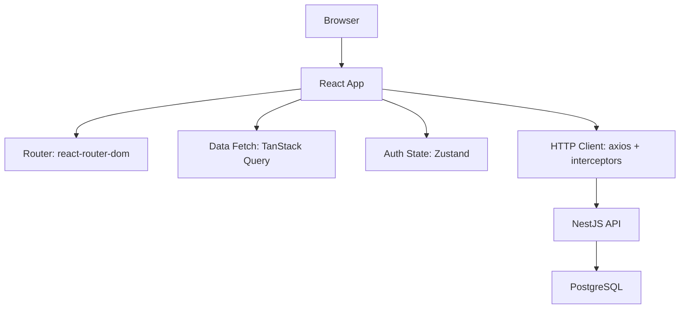

# システム構成図

## 1. 技術スタック

- Frontend
  - React + TypeScript
  - react-router-dom
  - TanStack Query
  - Zustand
  - axios
  - styled-components
  - react-toastify
- Backend
  - NestJS (Node.js)
  - Passport JWT
  - TypeORM
- Database
  - PostgreSQL
- Development
  - ESLint
  - Jest

## 2. アーキテクチャ概要

- 認証方式は「access token + refresh token」の2段構成
  - access token は Authorization ヘッダーで送信
  - refresh token は httpOnly Cookie で送信
- フロントのデータ取得は TanStack Query で管理
- 認証状態は Zustand (`useAuthStore`) で管理
- 検索条件とページングは URL クエリ (`useSearchParams`) を正本として管理

## 3. フロント構成

- Entry
  - `src/index.tsx`
  - `QueryClientProvider` と `BrowserRouter` を最上位で適用
  - `setupAxiosIntercepters()` を起動時に実行
- App
  - `src/App.tsx`
  - 初回起動で `initializeAuth()` を実行
- Route Guard
  - `src/components/AppRoute.tsx`
  - `authLoading` 中は待機表示
  - `userInfo.token` の有無で `/` と `/main` を制御

## 4. 状態管理

### 4-1. Zustand (`useAuthStore`)

- 管理対象
  - `userInfo` (id, name, icon_path, token)
  - `authLoading`
- 主な処理
  - `initializeAuth`: `/auth/refresh` -> `/user/me`
  - `logout`
  - `setUserInfo`

### 4-2. TanStack Query

- 投稿一覧
  - `queryKey: ["post", { page, searchName, searchWord }]`
- 投稿削除後
  - `invalidateQueries({ queryKey: ["post"] })`

## 5. APIクライアント構成

- `src/api/axiosIntercepter.ts`
  - request interceptor
    - public API 以外に Authorization ヘッダーを自動付与
  - response interceptor
    - 401 時に `/auth/refresh` を実行
    - `refreshPromise` で同時 refresh を1本化
    - 新 token で元リクエストを再送

## 6. バックエンド構成

- Controller
  - `AuthController`
  - `UserController`
  - `PostController`
- Guard
  - `AuthGuard('jwt')` で保護 API を検証
- CORS
  - `credentials: true`
  - `http://localhost:3001` / `http://127.0.0.1:3001` を許可

## 7. 構成図

