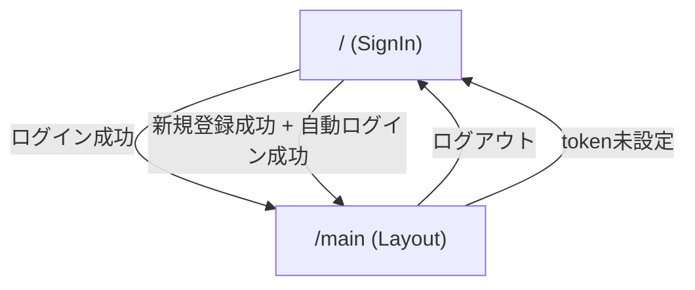

# 画面遷移図/UI設計

## 1. 画面一覧

### 1-1. サインイン/サインアップ画面 (`/`)

- 目的: ログインと新規登録
- 構成
  - `SignIn`
  - `SignUp`

### 1-2. メイン画面 (`/main`)

- 目的: 投稿作成と投稿一覧閲覧
- 認可要件: `useAuthStore().userInfo.token` が空でないこと
- 構成
  - `Header`（ロゴ、ユーザー名、ログアウト）
  - `SideBar`（新規投稿フォーム）
  - `Contents`（投稿一覧）

## 2. 画面遷移

## 3. ルーティング設計

- `AppRoute.tsx`
  - `path="/"` -> ログイン済なら `/main` へリダイレクト
  - `path="/main"` -> 未ログインなら `/` へリダイレクト
- `authLoading` 中は `Loading...` を表示して判定を保留

## 4. 認証UX設計

- 初回起動
  - `App.tsx` で `initializeAuth()` を実行
  - `/auth/refresh` -> `/user/me` で復元
- API呼び出し
  - interceptor が Authorization を自動付与
  - 401時は refresh 後に元リクエストを再送

## 5. 投稿一覧UX設計

- データ取得
  - TanStack Query (`useQuery`) で一覧を取得
  - queryKey は `page`, `name`, `word` を含む
- 検索条件
  - URL クエリ (`useSearchParams`) を正本として管理
  - 例: `?page=1&name=taro&word=hello`
- ページング
  - `page` クエリで前へ/次へを制御
  - 1ページ目では「前へ」ボタンを無効化
- 更新
  - 削除後は `invalidateQueries({ queryKey: ["post"] })` で再取得

## 6. UIコンポーネント設計

### 6-1. SignIn

- 入力項目: ユーザー名、パスワード
- 動作: `POST /auth`
- 成功時: token を store に保存し `/main` へ遷移

### 6-2. SignUp

- 入力項目: ユーザー名、メール、パスワード
- バリデーション: 必須、メール形式、パスワード6文字以上
- 動作: `POST /user/create` -> `POST /auth`

### 6-3. Header

- 表示: ロゴ、`<ユーザー名>さん`、ログアウト
- ログアウト: `DELETE /auth/logout` -> 未ログイン状態へ遷移

### 6-4. SideBar

- 投稿作成フォーム
- 入力検証: 空文字/140文字超過を制御

### 6-5. PostList

- フィルタ（投稿本文、投稿者名）
- ページング（前へ/次へ）
- `更新` ボタンで手動再取得

## 7. 状態管理

### 7-1. グローバル状態（Zustand）

- `useAuthStore`
  - `userInfo`
  - `authLoading`
  - `initializeAuth`, `logout`, `setUserInfo`

### 7-2. サーバー状態（TanStack Query）

- 投稿一覧 (`useQuery`)
- 投稿削除後の再取得 (`invalidateQueries`)

## 8. エラー表示方針

- APIエラーは `extractErrorMessage` で文字列化
- トースト通知（`react-toastify`）を共通利用

## 9. レイアウト方針

- メイン画面は2カラム構成
  - 左: 投稿入力
  - 右: 投稿一覧
- 投稿一覧は縦スクロール (`overflow-y: scroll`)

## 10. 今後の改善候補

- Query key の定数化
- 投稿作成/ユーザー更新処理の Mutation 化の統一
- モバイル向けレスポンシブ改善
